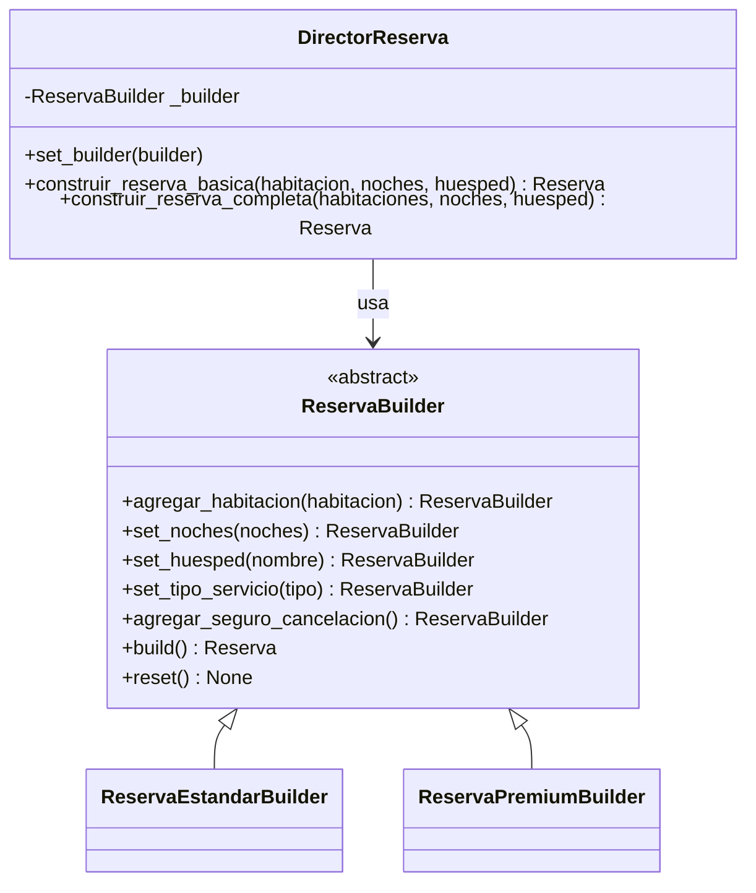

# Patrones de Diseño en Python — Sistema de Gestión Hotelera

Proyecto educativo que implementa ocho patrones de diseño clásicos del libro *Gang of Four* aplicados a un sistema de gestión hotelera simulado (el "Hotel Los Cortez"). Todo el código está escrito en Python usando únicamente la biblioteca estándar (sin dependencias externas).

**Equipo:** Desarrollo Los Cortez
**Asignatura:** Metodología de Sistemas 2
**Python:** 3.6+

## Autoevaluación

El [examen aplicado](evaluacion/examen_patrones.html) contiene 40 preguntas y 80 incisos
sobre los ocho patrones. Abrí el archivo HTML directamente en un navegador: funciona
sin conexión, permite corregir y revelar respuestas, y no guarda los intentos.
La [guía docente](evaluacion/guia_docente.md) incluye metodología, claves y explicaciones.

Para regenerar ambos archivos desde los bancos locales, ejecutá desde la raíz del proyecto
`python evaluacion/generar_examen.py`. No requiere dependencias externas.

---

## Introducción

Este proyecto simula el núcleo de la operación de un hotel con el objetivo de mostrar, en un contexto real y comprensible, cómo los patrones de diseño resuelven problemas concretos de arquitectura de software. Es el proyecto "gemelo" del sistema de comercio electrónico del mismo equipo: la arquitectura, las convenciones y la robustez son las mismas, pero el dominio cambia de una tienda en línea a un hotel.

Los ocho patrones están agrupados según la clasificación GoF:

**Creacionales** — controlan cómo se crean los objetos:
1. **Singleton** — una única central de reservas compartida durante toda la ejecución.
2. **Factory Method** — cada creador concreto (subclase) decide qué habitación instanciar (estándar o suite), sin exponer las clases concretas al código que las usa.
3. **Builder** — construcción paso a paso de reservas complejas con opciones variables (noches, tipo de servicio, seguro de cancelación), sin constructores con decenas de parámetros.

**Estructurales** — definen cómo se componen los objetos:
4. **Decorator** — agrega servicios opcionales a las habitaciones (desayuno incluido, seguro de viaje, late checkout) apilándolos dinámicamente en tiempo de ejecución.
5. **Adapter** — unifica la integración con dos proveedores de traslado (taxi y shuttle) que tienen APIs completamente distintas bajo una interfaz común.

**De comportamiento** — definen cómo interactúan los objetos:
6. **Observer** — notifica automáticamente a todos los huéspedes suscritos cuando el hotel publica una nueva promoción.
7. **Strategy** — permite elegir la política de tarifa (temporada alta, temporada baja, corporativa) en tiempo de ejecución sin modificar el cotizador.
8. **Chain of Responsibility** — valida una reserva a través de una cadena de controles (disponibilidad, régimen de comidas, huésped, monto máximo) donde cada eslabón puede aprobar o rechazar.

Cada patrón vive en su propio subpaquete dentro de `patrones/`. Siete patrones emplean interfaces abstractas (ABC) y clases concretas; Singleton controla directamente la creación de su única instancia.

---

## Patrones Implementados

| # | Categoría | Patrón | Propósito en el proyecto | Clases principales |
|---|-----------|--------|--------------------------|-------------------|
| 1 | Creacional | **Singleton** | Una única central de reservas en toda la app | `CentralReservas` |
| 2 | Creacional | **Factory Method** | Cada creador concreto decide qué tipo de habitación crear | `CreadorHabitacion`, `CreadorHabitacionEstandar`, `CreadorSuite`, `HabitacionEstandar`, `Suite` |
| 3 | Creacional | **Builder** | Construir reservas complejas paso a paso | `ReservaEstandarBuilder`, `ReservaPremiumBuilder`, `DirectorReserva` |
| 4 | Estructural | **Decorator** | Apilar servicios opcionales sobre habitaciones | `HabitacionBasica`, `DesayunoIncluido`, `SeguroViaje`, `LateCheckout` |
| 5 | Estructural | **Adapter** | Integrar servicios de traslado con APIs incompatibles | `AdaptadorTaxi`, `AdaptadorShuttle` |
| 6 | Comportamiento | **Observer** | Notificar a huéspedes suscritos ante nuevas promociones | `Hotel`, `Huesped` |
| 7 | Comportamiento | **Strategy** | Elegir la política de tarifa en tiempo de ejecución | `Cotizador`, `TarifaTemporadaAlta`, `TarifaTemporadaBaja`, `TarifaCorporativa` |
| 8 | Comportamiento | **Chain of Responsibility** | Validar reservas en cadena de responsabilidad | `ValidadorDisponibilidad`, `ValidadorRegimen`, `ValidadorHuesped`, `ValidadorMontoMaximo` |

---

## Estructura del Proyecto

```
Python8-Hotel/
├── main.py                              # Punto de entrada — demo de los 8 patrones
├── requirements.txt                     # Sin dependencias externas
├── historias1.md                        # Historias de usuario (40 HU, 9 épicas)
├── tests/                               # Suite unittest: un archivo por patrón + main + convenciones
└── patrones/                            # Paquete principal
    ├── __init__.py
    ├── _numeros.py                        # Validación del rango numérico compartida
    ├── creacionales/
    │   ├── __init__.py
    │   ├── singleton/
    │   │   ├── __init__.py              # Re-exporta: CentralReservas
    │   │   └── central_reservas.py
    │   ├── factory/
    │   │   ├── __init__.py              # Re-exporta: Habitacion, HabitacionEstandar, Suite, Creador*
    │   │   ├── habitacion.py
    │   │   └── creador_habitacion.py
    │   └── builder/
    │       ├── __init__.py              # Re-exporta: Reserva, ReservaBuilder, Reserva*Builder, DirectorReserva
    │       ├── reserva.py
    │       └── reserva_builder.py
    ├── estructurales/
    │   ├── __init__.py
    │   ├── decorator/
    │   │   ├── __init__.py              # Re-exporta: ComponenteHabitacion, HabitacionBasica, Decorador*, servicios
    │   │   └── decorador_habitacion.py
    │   └── adapter/
    │       ├── __init__.py              # Re-exporta: ServicioTraslado, SistemaLegado*, Adaptador*
    │       └── adaptador_traslado.py
    └── comportamiento/
        ├── __init__.py
        ├── observer/
        │   ├── __init__.py              # Re-exporta: Observer, Huesped, Hotel
        │   ├── observer.py
        │   └── hotel.py
        ├── strategy/
        │   ├── __init__.py              # Re-exporta: EstrategiaTarifa, Tarifa*, Cotizador
        │   ├── estrategia_tarifa.py
        │   └── cotizador.py
        └── chain/
            ├── __init__.py              # Re-exporta: ValidadorReserva, Validador*
            └── validador_reserva.py
```

Cada subpaquete de patrón expone sus clases públicas mediante `__init__.py` y `__all__`. Los imports públicos usan la ruta de tres niveles; `_numeros.py` es un módulo interno compartido:

Cada ejemplo Python incluye su salida esperada completa en el bloque contiguo.
Un bloque de salida vacío indica que el ejemplo no imprime nada.

```python
from patrones.creacionales.singleton import CentralReservas
from patrones.estructurales.adapter import AdaptadorTaxi
from patrones.comportamiento.chain import ValidadorDisponibilidad
```

**Salida esperada:**

```text
```

---

## Requisitos y Ejecución

**Requisitos:**
- Python 3.6 o superior
- Sin dependencias externas (solo biblioteca estándar de Python)

**Ejecutar la demo completa:**

```bash
python main.py
```

**Verificar patrones individualmente:**

```bash
# Singleton — confirma que dos llamadas devuelven el mismo objeto
python -c "from patrones.creacionales.singleton import CentralReservas; c1 = CentralReservas.get_instance(); c2 = CentralReservas.get_instance(); print('Singleton OK' if c1 is c2 else 'ERROR')"

# Factory Method — el creador concreto crea una habitación y se accede a su nombre como propiedad
python -c "from patrones.creacionales.factory import CreadorSuite; h = CreadorSuite('Vista al mar').crear_habitacion('Suite 501', 200.0); print('Factory Method OK' if h.nombre == 'Suite 501' else 'ERROR')"

# Builder — construye una reserva estándar simple
python -c "
from patrones.creacionales.builder import ReservaEstandarBuilder, DirectorReserva
from patrones.creacionales.factory import CreadorHabitacionEstandar
b = ReservaEstandarBuilder(); d = DirectorReserva(b)
r = d.construir_reserva_basica(CreadorHabitacionEstandar().crear_habitacion('Doble 101', 80.0), 2, 'Ana Pérez')
print('Builder OK' if r.calcular_total() > 0 else 'ERROR')
"

# Decorator — verifica apilamiento de precio: base 80 + desayuno 15 = 95
python -c "
from patrones.estructurales.decorator import HabitacionBasica, DesayunoIncluido
h = DesayunoIncluido(HabitacionBasica('Doble 101', 80.0))
print('Decorator OK' if h.precio == 95.0 else 'ERROR')
"

# Adapter — verifica que el adaptador de taxi devuelve un costo mayor que 0
python -c "
from patrones.estructurales.adapter import AdaptadorTaxi
a = AdaptadorTaxi()
print('Adapter OK' if a.calcular_costo(2.0, 'Palermo') > 0 else 'ERROR')
"

# Observer — suscribe un huésped dos veces y verifica que no se duplique
python -c "
from patrones.comportamiento.observer import Huesped, Hotel
h = Hotel('Test'); g = Huesped('Ana')
h.suscribir(g); h.suscribir(g)
print('Observer OK' if len(h._huespedes) == 1 else 'ERROR')
"

# Strategy — confirma una cotización y verifica que el cotizador quede vacío
python -c "
from patrones.creacionales.factory import CreadorHabitacionEstandar
from patrones.comportamiento.strategy import Cotizador, TarifaTemporadaBaja
c = Cotizador(); c.set_estrategia_tarifa(TarifaTemporadaBaja())
c.agregar_habitacion(CreadorHabitacionEstandar().crear_habitacion('Doble 101', 80.0))
c.confirmar()
print('Strategy OK' if c._habitaciones == [] else 'ERROR')
"

# Chain — verifica que una reserva válida pasa toda la cadena
python -c "
from patrones.comportamiento.chain import ValidadorDisponibilidad, ValidadorRegimen, ValidadorHuesped, ValidadorMontoMaximo
v = ValidadorDisponibilidad()
v.set_siguiente(ValidadorRegimen()).set_siguiente(ValidadorHuesped()).set_siguiente(ValidadorMontoMaximo())
r = v.validar({'habitaciones': ['x'], 'regimen': 'desayuno', 'huesped': 'Ana Pérez', 'total': 100})
print('Chain OK' if r else 'ERROR')
"
```

**Ejecutar la suite de tests** (`unittest`, biblioteca estándar):

```bash
python -m unittest discover -s tests -t .
```

Incluye un archivo de tests por patrón, un test de humo de `main.py` (criterios de HU-040),
un test de convenciones (líneas de hasta 100 caracteres, type hints en todas las firmas e
imports sin usar) y `test_doctests.py`, que ejecuta los ejemplos `>>>` de los docstrings.

---

## Contratos de entrada y manejo de errores

- Las tarifas y los precios aceptan `int` o `float` no negativos representables como float finito;
  `bool` se rechaza. Los enteros fuera de ese rango producen `ValueError`.
  Un tipo incorrecto produce `TypeError`; un valor negativo o no finito produce `ValueError`.
- El cotizador requiere `nombre`, `tarifa` y un método invocable `mostrar_info()`.
  Los builders requieren `nombre` y `tarifa`. No es necesario heredar de `Habitacion`.
  Las altas inválidas se rechazan antes de modificar las colecciones.
- Las noches de una reserva deben ser un `int` mayor o igual que 1 (`bool` se rechaza).
- Ambos adaptadores requieren una distancia numérica finita mayor que cero, excluyendo `bool`.
  Distancia, conversiones y tarifa deben permanecer en el rango finito de float; si se
  desbordan se lanza `ValueError`.
- Cotizador y Reserva conservan referencias a las habitaciones externas y revalidan sus
  tarifas al calcular. Una suma no finita produce `ValueError` antes de aplicar la tarifa.
  `SeguroViaje` también rechaza el desbordamiento del precio resultante.
- Los validadores rechazan reservas que no sean diccionarios. Disponibilidad requiere una lista
  no vacía y el monto máximo rechaza `NaN`, infinitos, booleanos, negativos y montos excesivos.
  Un total ausente equivale a cero, como establece HU-039.
- Las tres estrategias requieren montos `int`/`float` finitos y no negativos, sin `bool`.
  Comprueban también el resultado antes de imprimirlo. El cotizador valida el resultado
  de cualquier estrategia: tipo inválido produce `TypeError`; negativo, no finito o
  fuera de rango produce `ValueError`. Ante un error conserva habitaciones y estrategia,
  y no imprime la confirmación de éxito.
- Cada construcción del Director comienza con `reset()` y descarta cualquier producto
  parcial si falla. La reserva básica siempre carece de seguro; la completa lo activa.
  Los pasos manuales del builder siguen acumulándose hasta `build()` o `reset()`.

Ejemplo de validación de entradas (cada tarifa inválida se rechaza con un error explícito):

```python
from patrones.creacionales.factory import HabitacionEstandar

for tarifa in (-1, float("nan"), True, "80"):
    try:
        HabitacionEstandar("Doble 101", tarifa)
    except (TypeError, ValueError) as error:
        print(type(error).__name__, "-", error)
```

**Salida esperada:**

```text
ValueError - La tarifa no puede ser negativa: -1
ValueError - La tarifa debe ser un número finito
TypeError - La tarifa debe ser un número
TypeError - La tarifa debe ser un número
```

`tests/test_regresiones_validacion.py` cubre entradas inválidas y conservación del estado.
`tests/test_limites_numericos.py` cubre desbordamientos y cambios de tarifas externas.
`tests/test_documentacion.py` ejecuta cada ejemplo Python y compara su salida completa
con el bloque contiguo de salida esperada, incluidos los ejemplos que no imprimen nada.
También compara la salida completa publicada con `main.py`.
La ejecución se verificó en Python 3.12.10. La compatibilidad objetivo con Python 3.6+
se conserva en la sintaxis, pero no se ejecutó una matriz de versiones.

## Descripción Detallada de Cada Patrón

---

### 1. Singleton — `patrones/creacionales/singleton/`

**Problema que resuelve:** Compartir una única instancia de la central dentro de un proceso y ofrecer un punto de acceso global. El lock protege su creación e inicialización; no implementa inventario, transacciones ni prevención de reservas duplicadas. Cada proceso tiene su propia instancia. La herencia de esta clase queda fuera del contrato del ejemplo.

**Diagrama de clases:**

```
┌────────────────────────────────┐
│        CentralReservas         │
├────────────────────────────────┤
│ - _instance: cls (class var)   │
│ - _lock: threading.Lock (cls)  │
│ - _initialized: bool           │
│ - _hotel: str                  │
│ - _conectado: bool             │
├────────────────────────────────┤
│ + __new__(cls) -> self         │  ← controla la creación
│ + __init__(self) -> None       │  ← inicialización efectiva única
│ + get_instance() -> self       │  ← punto de acceso público
│ + consultar(consulta) -> None  │
│ @property hotel, conectado     │
└────────────────────────────────┘
```

**Uso:**

```python
from patrones.creacionales.singleton import CentralReservas

central1 = CentralReservas.get_instance()
central2 = CentralReservas.get_instance()   # ya existe: no se vuelve a crear

print(central1 is central2)
central1.consultar("Habitaciones libres del 10 al 13 de marzo")
print(central1.hotel)
```

**Salida esperada:**

```text
Conectando a la central de reservas de Hotel Los Cortez...
True
[CentralReservas] Ejecutando: Habitaciones libres del 10 al 13 de marzo
Hotel Los Cortez
```

**Implementación Python:**

Esta implementación de Singleton sobrescribe `__new__`, ya que es el método que crea el objeto antes de que `__init__` lo inicialice. Como Python llama a `__init__` siempre —incluso cuando `__new__` devuelve una instancia existente— se usa un flag `_initialized` para evitar la re-inicialización. Un `threading.Lock` de clase protege ambos pasos frente a hilos concurrentes ("double-checked locking"):

```python
import threading

class CentralReservas:
    _instance = None
    _lock = threading.Lock()

    def __new__(cls) -> "CentralReservas":
        if cls._instance is None:                 # chequeo rápido, sin lock
            with cls._lock:
                if cls._instance is None:         # chequeo seguro, con lock
                    cls._instance = super(CentralReservas, cls).__new__(cls)
                    cls._instance._initialized = False
        return cls._instance

    def __init__(self) -> None:
        with self._lock:
            if not self._initialized:
                self._hotel = "Hotel Los Cortez"
                self._conectado = True
                print(f"Conectando a la central de reservas de {self._hotel}...")
                self._initialized = True
```

**Salida esperada:**

```text
```

---

### 2. Factory Method — `patrones/creacionales/factory/`

**Problema que resuelve:** Crear habitaciones de distintos tipos sin que el código que las usa conozca las clases concretas, y poder agregar tipos nuevos sin modificar el código existente.

**Cómo lo resuelve:** El creador abstracto `CreadorHabitacion` declara el *factory method* `crear_habitacion()`. Cada subclase (creador concreto) lo sobreescribe y decide qué habitación instanciar. La operación `registrar_habitacion()` vive en el creador abstracto y usa el factory method sin saber qué clase concreta recibe.

**Diferencia con una Simple Factory:** en una Simple Factory una sola clase elige la habitación con un `if/elif` según un string, y cada tipo nuevo obliga a modificarla. En Factory Method, agregar un tipo nuevo es agregar un creador nuevo (principio abierto/cerrado).

**Diagrama de clases:**

```
┌──────────────────────────────────────────┐        ┌───────────────────┐
│       CreadorHabitacion  (ABC)           │ crea   │ Habitacion  (ABC) │
│──────────────────────────────────────────│ ─────▶ │───────────────────│
│ + crear_habitacion(nombre, tarifa)       │        │ @property nombre  │
│       -> Habitacion ← @abstractmethod    │        │ @property tarifa  │
│ + registrar_habitacion(nombre, tarifa)   │        │ + mostrar_info()  │
│       -> Habitacion ← usa el factory     │        └────────┬──────────┘
│                       method             │                 │
└───────────────────┬──────────────────────┘        ┌────────┴─────────┐
          ┌─────────┴──────────┐                    │                  │
┌─────────┴─────────┐ ┌────────┴───────────┐ ┌──────┴──────┐ ┌─────────┴────────┐
│ CreadorHabitacion │ │    CreadorSuite    │ │ Habitacion  │ │      Suite       │
│     Estandar      │ │────────────────────│ │  Estandar   │ │──────────────────│
│───────────────────│ │ # _vista           │ │─────────────│ │ # _vista         │
│ # _camas          │ │ crear_habitacion() │ │ # _camas    │ │ mostrar_info()   │
│ crear_habitacion()│ │   -> Suite         │ │ mostrar_info│ │ __repr__()       │
│   -> Habitacion   │ └────────────────────┘ │ __repr__()  │ └──────────────────┘
│      Estandar     │                        └─────────────┘
└───────────────────┘
```

**Uso:**

```python
from patrones.creacionales.factory import CreadorHabitacionEstandar, CreadorSuite

creador_dobles = CreadorHabitacionEstandar(2)        # camas por defecto: 2
creador_suites = CreadorSuite("Vista al mar")        # vista por defecto: "Vista al jardín"

doble = creador_dobles.crear_habitacion("Doble 101", 80.0)
print(doble.nombre)

# registrar_habitacion() usa el factory method y muestra la habitación
suite = creador_suites.registrar_habitacion("Suite 501", 200.0)
print(repr(suite))
```

**Salida esperada:**

```text
Doble 101
Suite: Suite 501 | Vista al mar | Tarifa: $200.00/noche
Suite(nombre='Suite 501', tarifa=200.0, vista='Vista al mar')
```

**Extender con un tipo nuevo** (sin modificar ninguna clase existente):

```python
from patrones.creacionales.factory import CreadorHabitacion, Habitacion

class Cabana(Habitacion):                       # 1) habitación nueva
    def mostrar_info(self) -> None:
        print(f"Cabaña: {self.nombre} | Tarifa: ${self.tarifa:.2f}/noche")

class CreadorCabana(CreadorHabitacion):         # 2) creador nuevo
    def crear_habitacion(self, nombre: str, tarifa: float) -> Cabana:
        return Cabana(nombre, tarifa)

CreadorCabana().registrar_habitacion("Cabaña del lago", 120.0)
```

**Salida esperada:**

```text
Cabaña: Cabaña del lago | Tarifa: $120.00/noche
```

---

### 3. Builder — `patrones/creacionales/builder/`

**Problema que resuelve:** Construir objetos complejos (reservas con múltiples habitaciones, noches, huésped, servicio y seguro) paso a paso sin que el cliente tenga que conocer ni gestionar cada detalle de construcción.

**Diagrama de clases:**



**Uso:**

```python
from patrones.creacionales.builder import (
    ReservaEstandarBuilder, ReservaPremiumBuilder, DirectorReserva
)
from patrones.creacionales.factory import CreadorHabitacionEstandar, CreadorSuite

doble = CreadorHabitacionEstandar(2).crear_habitacion("Doble 101", 80.0)
suite_mar = CreadorSuite("Vista al mar").crear_habitacion("Suite 501", 200.0)
suite_jardin = CreadorSuite().crear_habitacion("Suite 301", 150.0)

builder = ReservaEstandarBuilder()
director = DirectorReserva(builder)

# Reserva básica: el director ejecuta solo los pasos necesarios (sin seguro)
reserva = director.construir_reserva_basica(doble, 3, "Ana Pérez")
reserva.mostrar_resumen()

# Cambiar a premium en tiempo de ejecución sin recrear el director
director.set_builder(ReservaPremiumBuilder())
reserva_completa = director.construir_reserva_completa([suite_mar, suite_jardin], 2, "Luis Gómez")
reserva_completa.mostrar_resumen()
```

**Salida esperada:**

```text
  Habitación agregada: Doble 101 ($80.00/noche)
=== RESUMEN DE LA RESERVA ===
Huésped: Ana Pérez
Noches: 3
Habitaciones:
  - Doble 101 | $80.00/noche
Servicio: Estándar ($10.00)
Seguro de cancelación: No
Subtotal: $240.00
TOTAL: $250.00
=============================
  Habitación agregada: Suite 501 ($200.00/noche)
  Habitación agregada: Suite 301 ($150.00/noche)
=== RESUMEN DE LA RESERVA ===
Huésped: Luis Gómez
Noches: 2
Habitaciones:
  - Suite 501 | $200.00/noche
  - Suite 301 | $150.00/noche
Servicio: Premium ($40.00)
Seguro de cancelación: Sí (+$21.00)
Subtotal: $700.00
TOTAL: $761.00
=============================
```

**Nota clave — `build()` pisa el tipo de servicio:** `build()` siempre vuelve a aplicar la constante `TIPO_SERVICIO` y el `COSTO_SERVICIO` de su builder concreto (HU-011 y HU-012), de modo que una etiqueta asignada antes con `set_tipo_servicio()` se reemplaza al construir. Además, `build()` reinicia la reserva interna (`self._reserva = Reserva()`), lo que permite reutilizar el mismo builder. Los dos builders concretos duplican sus pasos a propósito, porque ambos deben heredar directamente de `ReservaBuilder`:

```python
from patrones.creacionales.builder import ReservaEstandarBuilder
from patrones.creacionales.factory import CreadorSuite

suite = CreadorSuite().crear_habitacion("Suite 301", 150.0)
builder = ReservaEstandarBuilder()

reserva = (builder.agregar_habitacion(suite)
           .set_noches(2)
           .set_huesped("Ana Pérez")
           .set_tipo_servicio("Cortesía")        # esta etiqueta se pierde en build()
           .agregar_seguro_cancelacion()
           .build())

print(reserva.tipo_servicio)
print(reserva.calcular_total())
print(reserva.noches)

otra = builder.build()             # el builder se reinició: reserva vacía y nueva
print(otra.habitaciones)
```

**Salida esperada:**

```text
  Habitación agregada: Suite 301 ($150.00/noche)
Estándar
319.0
2
[]
```

**Seguro de cancelación:** el seguro de la `Reserva` es el **3 % del subtotal** de habitaciones (`PORCENTAJE_SEGURO = 0.03`), no del total con servicio. Es una regla distinta del `SeguroViaje` del Decorator (2 % sobre el precio ya decorado): ambas están especificadas así.

**Estado y recuperación:** `ReservaBuilder` declara también `reset() -> None`, que cada
builder concreto implementa para iniciar un producto vacío. El Director llama a `reset()`
antes de cada receta y al finalizar, incluso si un paso falla. Por eso una receta básica
no conserva habitaciones ni seguro de una preparación anterior y se puede reintentar
después de corregir una entrada. Para construir manualmente por pasos, el cliente conserva
el estado hasta llamar a `build()` o descartarlo explícitamente mediante `reset()`.

---

### 4. Decorator — `patrones/estructurales/decorator/`

**Problema que resuelve:** Agregar responsabilidades a una habitación dinámicamente en tiempo de ejecución, sin crear una subclase para cada combinación posible de servicios (con tres servicios opcionales harían falta siete subclases; con Decorator bastan tres clases).

**Diagrama de clases:**

```
┌──────────────────────────┐
│   ComponenteHabitacion   │  (ABC)
│──────────────────────────│
│ @property descripcion    │  ← @abstractmethod
│ @property precio         │  ← @abstractmethod
└──────────────┬───────────┘
               │
    ┌──────────┴──────────┐
    │                     │
┌───┴──────────┐  ┌───────┴──────────────┐
│ Habitacion   │  │  DecoradorHabitacion │  (base instanciable, envuelve ComponenteHabitacion)
│ Basica       │  │──────────────────────│
│──────────────│  │ - _componente        │
│ __repr__()   │  │ @property descripcion│  ← delega a _componente
└──────────────┘  │ @property precio     │  ← delega a _componente
                  └──────────┬───────────┘
                             │
              ┌──────────────┼──────────────┐
              │              │              │
     ┌────────┴──┐  ┌────────┴──┐  ┌───────┴──────────┐
     │ Desayuno  │  │  Seguro   │  │   LateCheckout   │
     │ Incluido  │  │  Viaje    │  │                  │
     │ (+$15.00) │  │ (+2%)     │  │   (+$25.00)      │
     └───────────┘  └───────────┘  └──────────────────┘
```

**Uso:**

```python
from patrones.estructurales.decorator import (
    HabitacionBasica, DesayunoIncluido, SeguroViaje, LateCheckout
)

base          = HabitacionBasica("Suite Presidencial", 899.99)
con_desayuno  = DesayunoIncluido(base)
con_seguro    = SeguroViaje(con_desayuno)
con_late      = LateCheckout(con_seguro)

print(con_late.descripcion)
print(f"${con_late.precio:.2f}")
```

**Salida esperada:**

```text
Suite Presidencial + Desayuno incluido + Seguro de viaje + Late checkout
$958.29
```

**Nota clave:** `descripcion` y `precio` son `@property` (no métodos). `SeguroViaje` calcula el 2 % sobre `self._componente.precio` — el precio ya decorado, no el base — por lo que **el orden de apilado importa**. Esto contrasta a propósito con el seguro de cancelación de `Reserva` (Builder), que es el 3 % del subtotal:

```python
from types import SimpleNamespace

from patrones.creacionales.builder import Reserva
from patrones.estructurales.decorator import HabitacionBasica, DesayunoIncluido, SeguroViaje

# Orden de apilado: el seguro de viaje se calcula sobre el precio ya decorado
seguro_antes = DesayunoIncluido(SeguroViaje(HabitacionBasica("Doble 101", 100.0)))
seguro_despues = SeguroViaje(DesayunoIncluido(HabitacionBasica("Doble 101", 100.0)))
print(seguro_antes.precio)
print(seguro_despues.precio)

# Seguro de cancelación de la Reserva: 3% del subtotal de habitaciones
reserva = Reserva()
reserva.agregar_habitacion(SimpleNamespace(nombre="Doble 101", tarifa=100.0))
reserva.set_seguro_cancelacion(True)
print(reserva.calcular_total())
```

**Salida esperada:**

```text
117.0
117.3
103.0
```

---

### 5. Adapter — `patrones/estructurales/adapter/`

**Problema que resuelve:** Integrar sistemas externos con APIs incompatibles (taxi y shuttle del aeropuerto) bajo una interfaz unificada, sin modificar los sistemas originales. El taxi trabaja en metros y con nombres de barrio; el shuttle, en millas y con códigos de zona (`"Z1"`, `"Z2"`, `"Z3"`).

**Diagrama de clases:**

```
┌───────────────────────────┐
│      ServicioTraslado     │  (ABC — interfaz objetivo)
│───────────────────────────│
│ + calcular_costo(         │
│     distancia_km, zona)   │  ← @abstractmethod
│ + estimar_minutos(zona)   │  ← @abstractmethod
│ + crear_traslado(         │
│     reserva_id, zona)     │  ← @abstractmethod
└───────────┬───────────────┘
            │
   ┌────────┴────────┐
   │                 │
┌──┴──────────┐  ┌───┴───────────┐
│ Adaptador   │  │  Adaptador    │
│    Taxi     │  │   Shuttle     │
│─────────────│  │───────────────│
│ _taxi       │  │ _shuttle      │
│ km→metros   │  │ km→millas     │
│ parsea str  │  │ usa cod. zona │
└──────┬──────┘  └───────┬───────┘
       │                 │
┌──────┴──────┐  ┌───────┴───────┐
│ SistemaLeg  │  │ SistemaLeg    │
│  adoTaxi    │  │  adoShuttle   │
│ (adaptado)  │  │ (adaptado)    │
└─────────────┘  └───────────────┘
```

**Uso:**

```python
from patrones.estructurales.adapter import AdaptadorTaxi, AdaptadorShuttle

# El cliente usa SIEMPRE la misma interfaz — no sabe qué proveedor hay detrás
def cotizar(servicio, distancia_km, zona):
    print(f"Costo: ${servicio.calcular_costo(distancia_km, zona):.2f}")
    print(f"Minutos: {servicio.estimar_minutos(zona)}")
    print(f"Traslado: {servicio.crear_traslado('RES-001', zona)}")

cotizar(AdaptadorTaxi(),    2.5, "Palermo")  # convierte km→metros internamente
cotizar(AdaptadorShuttle(), 2.5, "Z1")       # convierte km→millas internamente
```

**Salida esperada:**

```text
Costo: $6.25
Minutos: 10
[Taxi] Móvil asignado para RES-001 hacia Palermo
Traslado: TAXI-RES-001-PAL
Costo: $6.79
Minutos: 20
[Shuttle] Asiento reservado para RES-001 (Z1)
Traslado: SHTRES-001Z1
```

| Adaptador | Conversión de distancia | Formato de zona | Minutos devueltos |
|-----------|------------------------|-----------------|-------------------|
| `AdaptadorTaxi` | km × 1000 → metros (`int(round(...))`) | nombre de barrio | parsea `"10-15 minutos"` → `10` |
| `AdaptadorShuttle` | km × 0.621 → millas (`round(..., 3)`) | código de zona (`Z1`, `Z2`, `Z3`) | entero directo |

**Notas de diseño:**

- `AdaptadorTaxi` convierte kilómetros a metros con `round()` y no con truncamiento: `int()` truncaría y subfacturaría la distancia.
- `AdaptadorTaxi.estimar_minutos()` parsea `"10-15 minutos"` separando por `"-"` y tomando el primer elemento.
- La comparación de barrios ignora mayúsculas, espacios en los extremos y tildes (`"  PALERMÓ "` equivale a `"palermo"`). Las zonas cercanas (`centro`, `recoleta`, `palermo`, `san telmo`) tienen tarifa y espera reducidas.
- Por especificación, `zona` es un barrio para el taxi y un código de zona para el shuttle; el shuttle estima 20 minutos para `Z1`, 35 para `Z2` y 50 para cualquier otro código.

```python
from patrones.estructurales.adapter import AdaptadorTaxi

taxi = AdaptadorTaxi()
print(taxi.calcular_costo(2.5, "  PALERMÓ "))
print(taxi.calcular_costo(2.5, "Belgrano"))
print(taxi.estimar_minutos("Belgrano"))
```

**Salida esperada:**

```text
6.25
8.75
25
```

---

### 6. Observer — `patrones/comportamiento/observer/`

**Problema que resuelve:** Cuando el hotel publica una promoción, notificar automáticamente a todos los huéspedes suscritos sin que el hotel conozca los detalles de cada uno.

**Diagrama de clases:**

```
┌──────────────────────────┐         ┌───────────────────────────────┐
│          Hotel           │         │          Observer             │ (ABC)
│──────────────────────────│  notif. │───────────────────────────────│
│ - _nombre: str           │────────►│ + actualizar(mensaje: str)    │
│ - _huespedes: List       │         └──────────────┬────────────────┘
│──────────────────────────│                        │
│ + suscribir(huesped)     │               ┌────────┴────────┐
│ + desuscribir(huesped)   │               │    Huesped      │
│ + notificar_huespedes(m) │               │─────────────────│
│ + nueva_promocion(desc)  │               │ - _nombre: str  │
└──────────────────────────┘               │ @property nombre│
                                           │ + actualizar()  │
                                           │ + __repr__()    │
                                           └─────────────────┘
```

**Uso:**

```python
from patrones.comportamiento.observer import Huesped, Hotel

hotel = Hotel("Hotel Los Cortez")
ana   = Huesped("Ana Pérez")
luis  = Huesped("Luis Gómez")

hotel.suscribir(ana)
hotel.suscribir(luis)
hotel.nueva_promocion("20% de descuento en suites")
# → Ana y Luis reciben la notificación

hotel.desuscribir(luis)
hotel.nueva_promocion("Semana de vacaciones: 3 noches al precio de 2")
# → solo Ana recibe la notificación
```

**Salida esperada:**

```text
Huésped suscrito al hotel Hotel Los Cortez
Huésped suscrito al hotel Hotel Los Cortez

¡Nueva promoción en Hotel Los Cortez!

--- Notificando a 2 huéspedes ---
Huésped Ana Pérez recibió notificación: Nueva promoción: 20% de descuento en suites
Huésped Luis Gómez recibió notificación: Nueva promoción: 20% de descuento en suites
Huésped desuscrito del hotel Hotel Los Cortez

¡Nueva promoción en Hotel Los Cortez!

--- Notificando a 1 huéspedes ---
Huésped Ana Pérez recibió notificación: Nueva promoción: Semana de vacaciones: 3 noches al precio de 2
```

**Validaciones implementadas en `Hotel`:**

| Situación | Comportamiento |
|-----------|---------------|
| `suscribir()` con objeto que no es `Observer` | Lanza `TypeError` |
| `suscribir()` con huésped ya suscrito | Imprime aviso, no duplica |
| `desuscribir()` con huésped no suscrito | Imprime aviso, no lanza excepción |
| Un observador se desuscribe dentro de `actualizar()` | `notificar_huespedes()` itera sobre una copia (`list(self._huespedes)`) y no se saltea al siguiente |

---

### 7. Strategy — `patrones/comportamiento/strategy/`

**Problema que resuelve:** Elegir la política de tarifa en tiempo de ejecución sin modificar el cotizador. Cada estrategia encapsula su lógica y es completamente intercambiable.

**Diagrama de clases:**

```
┌──────────────────────────┐       ┌─────────────────────────┐
│         Cotizador        │       │     EstrategiaTarifa    │  (ABC)
│  (Contexto)              │uses   │─────────────────────────│
│──────────────────────────│──────►│ + aplicar(monto: float) │
│ - _habitaciones: List    │       │       -> float          │
│ - _estrategia_tarifa     │       └────────────┬────────────┘
│──────────────────────────│                    │
│ + agregar_habitacion(h)  │       ┌────────────┼────────────┐
│ + set_estrategia_tarifa  │       │            │            │
│ + calcular_total() float │  ┌────┴─────┐ ┌────┴─────┐ ┌────┴──────┐
│ + confirmar() -> None    │  │ Tarifa   │ │ Tarifa   │ │ Tarifa    │
└──────────────────────────┘  │Temporada │ │Temporada │ │Corporativa│
                              │  Alta    │ │  Baja    │ │           │
                              └──────────┘ └──────────┘ └───────────┘
```

**Uso:**

```python
from patrones.comportamiento.strategy import (
    Cotizador, TarifaTemporadaAlta, TarifaTemporadaBaja, TarifaCorporativa
)
from patrones.creacionales.factory import CreadorSuite

suite = CreadorSuite("Vista al mar").crear_habitacion("Suite 501", 200.0)

cotizador = Cotizador()
cotizador.agregar_habitacion(suite)
cotizador.set_estrategia_tarifa(TarifaTemporadaAlta())
cotizador.confirmar()

# La estrategia se cambia en tiempo de ejecución, sin tocar el Cotizador
cotizador.agregar_habitacion(suite)
cotizador.set_estrategia_tarifa(TarifaCorporativa("Acme S.A."))
cotizador.confirmar()
```

**Salida esperada:**

```text
Habitación agregada a la cotización: Suite 501

=== COTIZACIÓN ===
Habitaciones cotizadas:
Suite: Suite 501 | Vista al mar | Tarifa: $200.00/noche
Subtotal: $200.00
[Temporada Alta] Recargo del 30% sobre $200.00: total $260.00
¡Cotización confirmada!

Habitación agregada a la cotización: Suite 501

=== COTIZACIÓN ===
Habitaciones cotizadas:
Suite: Suite 501 | Vista al mar | Tarifa: $200.00/noche
Subtotal: $200.00
[Corporativa - Acme S.A.] Descuento del 10% sobre $200.00: total $180.00
¡Cotización confirmada!

```

**Comportamiento de cada estrategia:**

| Estrategia | Constructor | Lógica de tarifa |
|------------|-------------|------------------|
| `TarifaTemporadaAlta` | sin parámetros | Recargo del 30 %: `round(monto * 1.30, 2)` |
| `TarifaTemporadaBaja` | sin parámetros | Descuento del 20 %: `round(monto * 0.80, 2)` |
| `TarifaCorporativa` | `empresa: str` | Descuento del 10 % por convenio: `round(monto * 0.90, 2)`; muestra la empresa |

`Cotizador.confirmar()` verifica que haya habitaciones y una estrategia configurada antes de procesar. Tras confirmar, **el cotizador se resetea** (`_habitaciones = []`, `_estrategia_tarifa = None`):

```python
from patrones.comportamiento.strategy import Cotizador, TarifaTemporadaBaja
from patrones.creacionales.factory import CreadorHabitacionEstandar

doble = CreadorHabitacionEstandar().crear_habitacion("Doble 101", 80.0)

cotizador = Cotizador()
cotizador.agregar_habitacion(doble)
cotizador.set_estrategia_tarifa(TarifaTemporadaBaja())
cotizador.confirmar()

print(cotizador.habitaciones)
print(cotizador.estrategia_tarifa)
```

**Salida esperada:**

```text
Habitación agregada a la cotización: Doble 101

=== COTIZACIÓN ===
Habitaciones cotizadas:
Habitación Estándar: Doble 101 | Camas: 2 | Tarifa: $80.00/noche
Subtotal: $80.00
[Temporada Baja] Descuento del 20% sobre $80.00: total $64.00
¡Cotización confirmada!

[]
None
```

---

### 8. Chain of Responsibility — `patrones/comportamiento/chain/`

**Problema que resuelve:** Validar una reserva a través de múltiples controles independientes, donde cada uno decide si continúa la cadena o la detiene. Cada regla es una clase aislada y la cadena es configurable en tiempo de ejecución.

**Diagrama de clases:**

```
┌──────────────────────────────┐
│       ValidadorReserva       │  (ABC)
│──────────────────────────────│
│ - _siguiente: Optional[self] │
│──────────────────────────────│
│ + set_siguiente(v) -> v      │  ← permite chaining: a.set_siguiente(b).set_siguiente(c)
│ + validar(reserva: dict) bool│  ← @abstractmethod
│ # _pasar_al_siguiente(r)     │  ← delega al siguiente o retorna True si es el último
└──────────────┬───────────────┘
               │
   ┌───────────┼───────────┬──────────────┐
   │           │           │              │
┌──┴────┐  ┌──┴────┐  ┌───┴──────┐  ┌───┴──────┐
│Valida-│  │Valida-│  │Validador │  │Validador │
│dorDis-│  │dorRegi│  │ Huesped  │  │  Monto   │
│ponibi-│  │men    │  │          │  │  Maximo  │
│lidad  │  │       │  │          │  │          │
│≥1 hab.│  │4 regí-│  │≥5 chars  │  │≤$10000   │
│       │  │menes  │  │          │  │          │
└───────┘  └───────┘  └──────────┘  └──────────┘
```

**Uso:**

```python
from patrones.comportamiento.chain import (
    ValidadorDisponibilidad, ValidadorRegimen, ValidadorHuesped, ValidadorMontoMaximo
)

# Construir la cadena con encadenamiento fluido
validador = ValidadorDisponibilidad()
validador \
    .set_siguiente(ValidadorRegimen()) \
    .set_siguiente(ValidadorHuesped()) \
    .set_siguiente(ValidadorMontoMaximo())

reserva = {
    "habitaciones": ["Doble 101", "Suite 501"],
    "regimen": "desayuno",
    "huesped": "Ana Pérez",
    "total": 950.00,
}
resultado = validador.validar(reserva)
print("APROBADA" if resultado else "RECHAZADA")
```

**Salida esperada:**

```text
  [Disponibilidad] OK: 2 habitación(es) solicitada(s).
  [Régimen] OK: régimen 'desayuno' aceptado.
  [Huésped] OK: 'Ana Pérez'.
  [Monto] OK: total $950.00 dentro del límite permitido.
APROBADA
```

**Validadores disponibles:**

| Clase | Regla | Falla cuando |
|-------|-------|-------------|
| `ValidadorDisponibilidad` | Lista no vacía | `habitaciones` falta, está vacía o no es lista |
| `ValidadorRegimen` | Régimen aceptado | no es `"solo alojamiento"`, `"desayuno"`, `"media pension"` ni `"pension completa"` (compara con `strip().lower()`) |
| `ValidadorHuesped` | Nombre con ≥ 5 caracteres (tras `strip()`) | nombre muy corto o vacío |
| `ValidadorMontoMaximo` | Total numérico finito entre 0 y $10000 | Tipo inválido, bool, no finito, fuera de rango, negativo o mayor al límite; ausente equivale a 0 |

Todos los validadores rechazan con el mensaje `[Reserva] RECHAZADO: se requiere un diccionario.` cuando reciben algo que no es un `dict`. `ValidadorRegimen` lista los regímenes aceptados con `sorted()` para que el mensaje sea determinista, y `set_siguiente()` lanza `ValueError` si el enlace formaría un ciclo.

---

## Integración entre Patrones

`main.py` demuestra cómo los ocho patrones coexisten en un escenario realista. Las habitaciones creadas por **Factory Method** se reutilizan directamente en **Strategy** y **Builder**, y **Chain** valida diccionarios de ejemplo independientes. Decorator y Adapter también tienen demostraciones propias; la cotización no los ejecuta automáticamente:

```
main.py
  │
  ├── Singleton ──── Una central de reservas compartida en toda la ejecución
  │
  ├── Factory Method  CreadorHabitacionEstandar / CreadorSuite crean: doble, simple, suite_mar, suite_jardin
  │        └───────── Las mismas habitaciones se reutilizan en Strategy y Builder
  │
  ├── Observer ────── Hotel notifica a 3 huéspedes → desuscribe 1 → notifica a 2
  │
  ├── Strategy ─────  cotizador1 (doble + suite_mar)       → TarifaTemporadaAlta
  │                   cotizador2 (simple + doble)          → TarifaTemporadaBaja
  │                   cotizador3 (suite_jardin + suite_mar) → TarifaCorporativa
  │
  ├── Builder ──────  director + ReservaEstandarBuilder → reserva básica
  │                   director + ReservaPremiumBuilder  → reserva completa
  │
  ├── Decorator ────  HabitacionBasica → DesayunoIncluido → SeguroViaje → LateCheckout
  │
  ├── Adapter ──────  AdaptadorTaxi    → misma interfaz ServicioTraslado
  │                   AdaptadorShuttle → misma interfaz ServicioTraslado
  │
  └── Chain ─────────  Disponibilidad → Régimen → Huésped → Monto máximo
                        reserva válida   → APROBADA
                        régimen inválido → RECHAZADA en ValidadorRegimen
                        monto excesivo   → RECHAZADA en ValidadorMontoMaximo
```

---

## Alcance didáctico y decisiones de diseño

Las demostraciones usan memoria y consola: no reservan habitaciones reales, no consultan
inventario, no persisten datos ni ejecutan pagos. `ValidadorDisponibilidad` comprueba que
exista una lista no vacía; `ValidadorHuesped` comprueba una longitud mínima, no la identidad
de una persona. La ausencia de total equivale a cero por el contrato de la cadena.

El Adapter oculta diferencias técnicas, pero conserva las entradas de cada proveedor:
el taxi recibe un barrio y el shuttle un código. Cambiar de proveedor para un mismo
destino de negocio requeriría un mapeo adicional. El shuttle normaliza su código con
`strip().upper()` tanto al estimar minutos como al generar el identificador.

Observer ejecuta las notificaciones de forma síncrona. Una excepción de un observador
se propaga y detiene ese envío; no hay reintentos ni aislamiento de suscriptores.
La copia de la lista permite darse de baja durante una notificación sin saltar al siguiente.
Chain se usa como cadena de validaciones: cada eslabón aprueba y delega, o rechaza y corta.

Las clases imprimen sus resultados para hacer visible la colaboración entre objetos.
`Cotizador.confirmar()` devuelve `None`; para una aplicación con interfaz gráfica sería
conveniente separar el resultado del cálculo y su presentación. `float` y `round()` son
parte del ejercicio y no proporcionan aritmética decimal exacta.

| Patrón | Costo o límite que debe valorar el estudiante |
|---|---|
| Singleton | Introduce estado global y exige aislamiento en pruebas; un objeto inyectado puede bastar. |
| Factory Method | Añade creadores; aporta valor si las subclases deben decidir el producto. |
| Builder | Añade pasos y estado; para pocos datos obligatorios puede bastar un constructor. |
| Decorator | El orden puede cambiar el precio; hay que comprender toda la composición. |
| Adapter | Traduce una API, pero no resuelve por sí solo diferencias del dominio. |
| Observer | Introduce callbacks y decisiones sobre errores y ciclo de vida de suscriptores. |
| Strategy | Añade clases; permite intercambiar políticas sin modificar el contexto. |
| Chain | El orden y los validadores elegidos determinan las garantías de la validación. |

### Ejercicios de extensión

1. Crear una habitación y su creador sin modificar los creadores existentes.
2. Agregar una estrategia de tarifa con pruebas de cero, un monto normal y límites numéricos.
3. Crear un builder que implemente todos los pasos, incluido `reset()`, y usarlo con el Director.
4. Crear un decorador y comparar su precio al colocarlo antes y después de `SeguroViaje`.
5. Adaptar un tercer proveedor y explicar qué diferencias técnicas y semánticas permanecen.
6. Agregar un observador que se dé de baja durante una notificación.
7. Agregar un validador y demostrar que un rechazo impide ejecutar los eslabones posteriores.

Cada ejercicio debe justificar qué colaboración mejora el patrón y verificar su
comportamiento con `unittest`, sin añadir dependencias externas.

## Características de Python Utilizadas

| Característica | Dónde se usa |
|----------------|-------------|
| `__new__` + `_initialized` | Singleton — controla instancia única sin re-inicialización |
| `abc.ABC` + `@abstractmethod` | Todos salvo Singleton — define miembros abstractos |
| `@property @abstractmethod` | Decorator — declara propiedades abstractas; las subclases deben conservar ese contrato |
| `@property` | Factory Method, Decorator, Observer — acceso a datos sin getters explícitos |
| `__repr__` | `HabitacionEstandar`, `Suite`, `HabitacionBasica`, `Huesped`, `Reserva` — representación para depuración |
| `@staticmethod` | `CentralReservas.get_instance()` — punto de acceso global sin instancia previa |
| Herencia + sobreescritura | Factory Method — cada creador concreto sobreescribe `crear_habitacion()` |
| `isinstance()` | `Hotel.suscribir()` — validación de tipo en runtime |
| `round(x, 2)` | Estrategias de tarifa, decoradores — redondea a dos decimales; no garantiza aritmética decimal exacta |
| `unicodedata` | Adapter — normaliza barrios sin tildes ni mayúsculas |
| `from typing import ...` | Type hints en todas las firmas — compatible con Python 3.6+ |
| f-strings | Toda la capa de presentación (`print`) |
| `__all__` en `__init__.py` | Declara la API pública de cada subpaquete |

---

## Salida Completa del Programa

```
==================================================
DEMOSTRACIÓN DE PATRONES DE DISEÑO EN PYTHON
SISTEMA DE GESTIÓN HOTELERA
==================================================

>>> 1. PATRÓN SINGLETON <<<
Conectando a la central de reservas de Hotel Los Cortez...
¿Son la misma instancia? True
[CentralReservas] Ejecutando: Habitaciones libres del 10 al 13 de marzo

>>> 2. PATRÓN FACTORY METHOD <<<
Habitación Estándar: Doble 101 | Camas: 2 | Tarifa: $80.00/noche
Habitación Estándar: Simple 102 | Camas: 1 | Tarifa: $55.50/noche
Suite: Suite 501 | Vista al mar | Tarifa: $200.00/noche
Suite: Suite 301 | Vista al jardín | Tarifa: $150.00/noche
Acceso por propiedades -> nombre: Doble 101 | tarifa: $80.00

>>> 3. PATRÓN OBSERVER <<<
Huésped suscrito al hotel Hotel Los Cortez
Huésped suscrito al hotel Hotel Los Cortez
Huésped suscrito al hotel Hotel Los Cortez

¡Nueva promoción en Hotel Los Cortez!

--- Notificando a 3 huéspedes ---
Huésped Ana Pérez recibió notificación: Nueva promoción: 20% de descuento en suites
Huésped Luis Gómez recibió notificación: Nueva promoción: 20% de descuento en suites
Huésped Marta Díaz recibió notificación: Nueva promoción: 20% de descuento en suites

Huésped desuscrito del hotel Hotel Los Cortez


¡Nueva promoción en Hotel Los Cortez!

--- Notificando a 2 huéspedes ---
Huésped Ana Pérez recibió notificación: Nueva promoción: Semana de vacaciones: 3 noches al precio de 2
Huésped Marta Díaz recibió notificación: Nueva promoción: Semana de vacaciones: 3 noches al precio de 2

>>> 4. PATRÓN STRATEGY <<<
Habitación agregada a la cotización: Doble 101
Habitación agregada a la cotización: Suite 501

=== COTIZACIÓN ===
Habitaciones cotizadas:
Habitación Estándar: Doble 101 | Camas: 2 | Tarifa: $80.00/noche
Suite: Suite 501 | Vista al mar | Tarifa: $200.00/noche
Subtotal: $280.00
[Temporada Alta] Recargo del 30% sobre $280.00: total $364.00
¡Cotización confirmada!

Habitación agregada a la cotización: Simple 102
Habitación agregada a la cotización: Doble 101

=== COTIZACIÓN ===
Habitaciones cotizadas:
Habitación Estándar: Simple 102 | Camas: 1 | Tarifa: $55.50/noche
Habitación Estándar: Doble 101 | Camas: 2 | Tarifa: $80.00/noche
Subtotal: $135.50
[Temporada Baja] Descuento del 20% sobre $135.50: total $108.40
¡Cotización confirmada!

Habitación agregada a la cotización: Suite 301
Habitación agregada a la cotización: Suite 501

=== COTIZACIÓN ===
Habitaciones cotizadas:
Suite: Suite 301 | Vista al jardín | Tarifa: $150.00/noche
Suite: Suite 501 | Vista al mar | Tarifa: $200.00/noche
Subtotal: $350.00
[Corporativa - Acme S.A.] Descuento del 10% sobre $350.00: total $315.00
¡Cotización confirmada!

>>> 5. PATRÓN BUILDER <<<
-- Reserva estándar básica --
  Habitación agregada: Doble 101 ($80.00/noche)
=== RESUMEN DE LA RESERVA ===
Huésped: Ana Pérez
Noches: 3
Habitaciones:
  - Doble 101 | $80.00/noche
Servicio: Estándar ($10.00)
Seguro de cancelación: No
Subtotal: $240.00
TOTAL: $250.00
=============================

-- Reserva premium completa --
  Habitación agregada: Suite 501 ($200.00/noche)
  Habitación agregada: Suite 301 ($150.00/noche)
=== RESUMEN DE LA RESERVA ===
Huésped: Luis Gómez
Noches: 2
Habitaciones:
  - Suite 501 | $200.00/noche
  - Suite 301 | $150.00/noche
Servicio: Premium ($40.00)
Seguro de cancelación: Sí (+$21.00)
Subtotal: $700.00
TOTAL: $761.00
=============================

>>> 6. PATRÓN DECORATOR <<<
Base:                Suite Presidencial
                     Precio: $899.99
+ DesayunoIncluido:  Suite Presidencial + Desayuno incluido
                     Precio: $914.99
+ SeguroViaje:       Suite Presidencial + Desayuno incluido + Seguro de viaje
                     Precio: $933.29
+ LateCheckout:      Suite Presidencial + Desayuno incluido + Seguro de viaje + Late checkout
                     Precio: $958.29

>>> 7. PATRÓN ADAPTER <<<
-- Traslado en taxi (adaptador convierte km->metros, parsea 'X-Y minutos') --
  [Taxi] Costo: $6.25 | Minutos estimados: 10
[Taxi] Móvil asignado para RES-001 hacia Palermo
  [Taxi] Identificador: TAXI-RES-001-PAL

-- Traslado en shuttle (adaptador convierte km->millas, usa código de zona) --
  [Shuttle] Costo: $6.79 | Minutos estimados: 20
[Shuttle] Asiento reservado para RES-001 (Z1)
  [Shuttle] Identificador: SHTRES-001Z1

>>> 8. PATRÓN CHAIN OF RESPONSIBILITY <<<
-- Reserva válida --
  [Disponibilidad] OK: 2 habitación(es) solicitada(s).
  [Régimen] OK: régimen 'desayuno' aceptado.
  [Huésped] OK: 'Ana Pérez'.
  [Monto] OK: total $950.00 dentro del límite permitido.
  Resultado: APROBADA

-- Reserva con régimen de comidas no ofrecido --
  [Disponibilidad] OK: 1 habitación(es) solicitada(s).
  [Régimen] RECHAZADO: régimen 'todo incluido' no está disponible. Aceptados: desayuno, media pension, pension completa, solo alojamiento.
  Resultado: RECHAZADA

-- Reserva con monto que supera el límite permitido --
  [Disponibilidad] OK: 3 habitación(es) solicitada(s).
  [Régimen] OK: régimen 'pension completa' aceptado.
  [Huésped] OK: 'Marta Díaz'.
  [Monto] RECHAZADO: total $12500.00 supera el límite de $10000.00.
  Resultado: RECHAZADA

==================================================
FIN DE LA DEMOSTRACIÓN
==================================================
```

---

## Licencia

Proyecto educativo — uso libre para aprendizaje y estudio.
